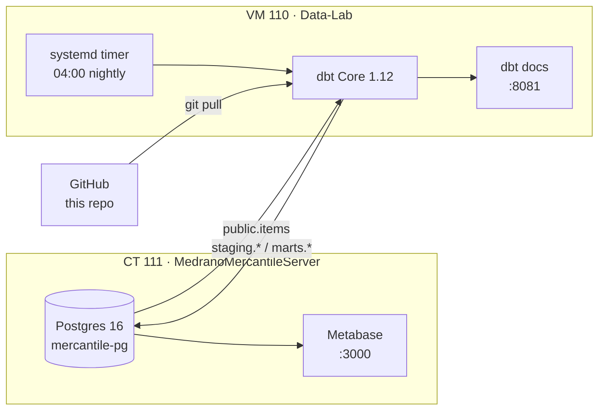
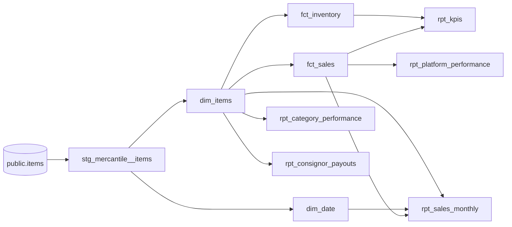

# Medrano Mercantile — dbt

[](https://github.com/manofmanana/medrano-mercantile-dbt/actions/workflows/ci.yml)


The analytics layer for **Medrano Mercantile**, a small reselling and consignment
business. This project turns the raw inventory ledger into clean, tested tables
that power the Metabase dashboard: revenue, profit, sell-through, inventory aging
and consignor payouts.

---

## Architecture



| Piece | Where | Notes |
|---|---|---|
| Source data | `mercantile` DB → `public.items` | One row per item, edited in place |
| dbt runner | Data-Lab (VM 110, `192.168.1.128`) | `/opt/dbt-projects/medrano`, venv at `/opt/dbt` |
| Schedule | `dbt-nightly.timer` | 04:00 daily: `git pull` → `dbt build` → `dbt docs generate` |
| Docs site | http://dbt.home · http://192.168.1.128:8081 | Lineage graph and column docs |
| Dashboard | Metabase on CT 111 (`:3000`) | Reads only from `marts.*` |

---

## Data model



| Layer | Schema | Model | Grain | Purpose |
|---|---|---|---|---|
| Staging | `staging` | `stg_mercantile__items` | item | Typed dates, trimmed text, normalized categories, explicit defaults |
| Core | `marts` | `dim_date` | day | Calendar spine so charts don't skip empty periods |
| Core | `marts` | `dim_items` | item | Full lifecycle, holding time, payout, profit |
| Core | `marts` | `fct_sales` | sold item | Revenue, margin, discount, days to sell |
| Core | `marts` | `fct_inventory` | unsold item | Aging buckets, stale flag, potential profit |
| Reporting | `marts` | `rpt_kpis` | 1 row | Headline tiles + 30-day vs prior-30-day |
| Reporting | `marts` | `rpt_sales_monthly` | month | Zero-filled trend, running totals, MoM change |
| Reporting | `marts` | `rpt_category_performance` | category | Sales, open stock, sell-through |
| Reporting | `marts` | `rpt_platform_performance` | platform | Where things sell best |
| Reporting | `marts` | `rpt_consignor_payouts` | consignor | Placed / sold / owed |

### Metric definitions

| Metric | Definition |
|---|---|
| **Revenue** | Sum of `sale_price` for sold items |
| **Consignor payout** | `sale_price × owner_split` for consigned items, else 0 |
| **Net profit** | `sale_price − consignor payout − fees − acquisition cost` |
| **Profit margin** | Net profit ÷ revenue |
| **Days to sell** | `sold_date − listed_date` |
| **Sell-through rate** | Items sold ÷ all items taken in |
| **Stale inventory** | Unsold and on hand > `stale_inventory_days` (default **60**) |

---

## Data quality

Every `dbt build` runs **57 checks** before the dashboard sees new data:

- **Keys** — `sku` unique and not null at every layer; `fct_sales` → `dim_items` relationship
- **Domains** — `status` ∈ Received/Listed/Sold, `source_type` ∈ Owned/Consignment/Donation, aging buckets
- **Ranges** — money columns non-negative (`non_negative`), splits and rates within 0–1 (`between`)
- **Business rules** (`tests/singular/`)
  - dates in order: received ≤ listed ≤ sold
  - sold items have a price and date; unsold items have neither
  - monthly report reconciles to `fct_sales` to the cent
- **Freshness** — warns if `public.items` hasn't been edited in 30 days

If a test fails, `dbt build` skips everything downstream, so the dashboard keeps
showing the last good numbers instead of bad ones.

---

## Running it

### On Data-Lab (production)

```bash
sudo systemctl start dbt-nightly.service      # run now, same as the 04:00 job
tail -f /var/log/dbt/nightly.log              # watch it
systemctl list-timers dbt-nightly.timer       # next scheduled run
```

### Locally

```bash
python -m venv .venv && source .venv/bin/activate
pip install "dbt-core~=1.12.0" "dbt-postgres~=1.11.0"
cp profiles.example.yml ~/.dbt/profiles.yml
export DBT_PASSWORD=...                       # see /etc/dbt/dbt.env on Data-Lab

dbt debug                                     # check the connection
dbt build                                     # run models + tests
dbt build -s +rpt_kpis                        # one model and everything upstream
dbt docs generate && dbt docs serve           # browse lineage locally
```

### Making a change

1. Branch, edit models, run `dbt build -s state:modified+` locally.
2. Open a PR — CI runs `dbt parse --warn-error` and checks every model is documented.
3. Merge to `main`. Data-Lab pulls and builds it at the next 04:00 run (or run it now with the command above).

---

## Conventions

- **Staging** models are 1:1 with a source table, named `stg_<source>__<table>`, materialized as views. Renaming, casting and cleaning only — no joins or business logic.
- **Core** models are `dim_*` (things) and `fct_*` (events), materialized as tables.
- **Reporting** models are `rpt_*`, shaped for exactly one dashboard card each, tagged `metabase`.
- Money is `numeric(12,2)`; ratios are 0–1 decimals with 4 places (format as % in Metabase).
- Every model and key column has a description; table and column comments are pushed to Postgres (`persist_docs`), so they also show up in Metabase.
- `macros/generate_schema_name.sql` writes to the plain `staging` / `marts` schemas instead of dbt's default prefixed names.

## Repository layout

```
├── models/
│   ├── staging/mercantile/   source definition + stg model
│   └── marts/
│       ├── core/             dim_date, dim_items, fct_sales, fct_inventory
│       └── reporting/        rpt_* tables for Metabase
├── macros/                   schema naming, money / safe_ratio helpers
├── tests/
│   ├── generic/              non_negative, between, row_count_is
│   └── singular/             business-rule assertions
├── ci/profiles.yml           dummy profile for CI parsing
└── profiles.example.yml      template for ~/.dbt/profiles.yml
```

## Database access

| Role | Can do |
|---|---|
| `dbt` | Read `public`; owns and writes `staging` and `marts` |
| everyone else | Read `staging` and `marts` (via default privileges) |

The legacy `analytics` schema (built by the old Airflow DAG on CT 111) is left in place for now; nothing in this project reads from or writes to it.
